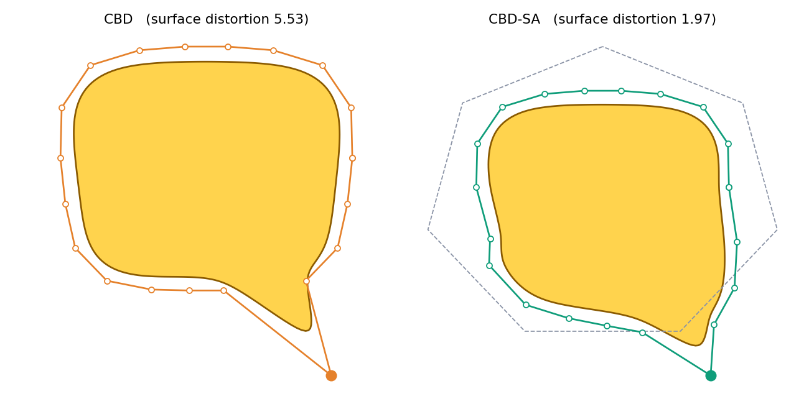
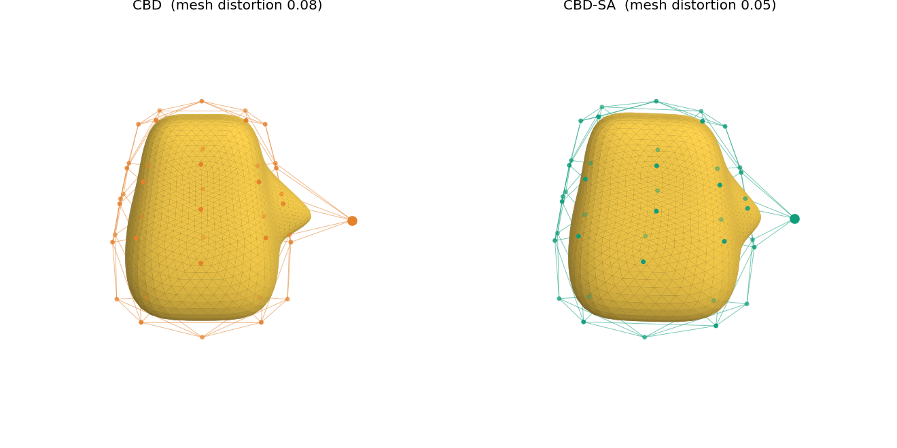

# Structural Affinity

Reference implementation of **Structural Affinity: An Algorithm for Coherent Cage-Based Shape Design**
(Aviraj Newatia, Shengan Yang, Hantao Zhong, Rika Antonova, University of Cambridge).

**[Project page](https://camral.github.io/structural-affinity/)** ·
**[Paper (PDF)](https://camral.github.io/structural-affinity/static/pdf/structural-affinity.pdf)**

In cage-based deformation (CBD) every handle moves on its own, so optimizers and networks find spiky,
tangled shapes. Structural Affinity wraps the control cage in a coarser **outer cage** and lets handles
that hang off it the same way move together. You build one sparse matrix offline. At run time it costs one
sparse product, and you don't need extra loss terms.



## Use it

The core is a single file, [`structural_affinity.py`](structural_affinity.py), which needs only numpy and
scipy. Copy it into your project. For PyTorch pipelines, also copy
[`structural_affinity_torch.py`](structural_affinity_torch.py).

```python
from structural_affinity import StructuralAffinity

# offline, once per inner cage
affinity = StructuralAffinity.from_cage(cage_verts, alpha=0.3, density=0.4)

# wherever your pipeline turns handle displacements D (N, 3) into a deformed cage:
deformed_cage = cage_verts + affinity.propagate(D)      # was: cage_verts + D
```

That is the whole integration. Your cage-to-mesh weights (MVC, Green, harmonic, ...), your optimizer and
your losses stay as they are. `propagate` also accepts a batch `(B, N, d)`.

PyTorch (differentiable, works as a sparse buffer on any device):

```python
from structural_affinity_torch import AffinityPropagation

propagate = AffinityPropagation(affinity.C, alpha=affinity.alpha).to(device)
cage_deformed = cage + propagate(net(x))                 # net predicts (B, N, 3) offsets
```

## How it works

| step | when | what | code |
|---|---|---|---|
| 1 | offline | Enclose the inner cage (N handles) in a convex outer cage (M handles) | `icosahedral_outer_cage`, `convex_outer_cage`, `box_outer_cage` |
| 2 | offline | Mean-value coordinates of each inner handle w.r.t. the outer cage, `W` (N, M) | `mvc` |
| 3 | offline | Affinity `C_ij = Σ_k min(w_ik, w_jk)`: symmetric, in [0, 1], unit diagonal | `affinity_matrix` |
| 4 | offline | Keep the diagonal and the strongest off-diagonal entries | `sparsify` |
| 5 | every step | `ΔV = A D`, with `A = (1 − α) I + α Cᵀ` | `propagate` |

A handle you move keeps its displacement exactly, and every other handle `j` follows by `α · C_ij` times
that displacement. For a dense `C`, `A` is invertible for `α < 1`, so every cage motion is still reachable.
Structural Affinity changes which shapes are *easy* to reach, not which are *possible*.

Each step is a short, plain function. Read the file top to bottom.

## Choosing the parameters

**`alpha` (affinity strength).** `0` is plain CBD. Larger values make handles move more collectively.

**`density` (d).** The fraction of off-diagonal pairs kept, strongest first, in symmetric pairs. `0`
decouples every handle and `1` keeps `C` dense. Use `eps=` instead to drop entries below a threshold.

Values used in the paper:

| setting | α | d | outer cage |
|---|---|---|---|
| Neural Cages (chair / table / car) | 0.3 / 0.2 / 0.4 | 0.4 | 12-vertex icosahedral support |
| Robot fingertips | 0.35 | 0.15 | axis-aligned box, padded by 5% of the bbox diagonal |
| Wing (perturbed starts) | 0.05 | 0.025 | padded convex hull of the inner cage |

A practical starting range is α ∈ [0.1, 0.45] and d ∈ [0.2, 0.7].

The paper's research code measured density over the full N×N matrix, including the diagonal. This file uses
the off-diagonal definition the paper describes. In the settings above the two differ only slightly (for
example, full-matrix 0.4 at N = 42 is 0.385 here).

**Outer cage.** It must be **convex** and **strictly enclose** the inner cage, so that every MVC weight is
positive. `from_cage` checks this and raises an error otherwise. A coarse, simple support is enough. The
default is an icosahedron (a 7-gon in 2D) stretched to the inner cage's bounding box.

## Things to know

- **Translations are amplified.** The update is not normalized: if every handle moves by `z`, handle `j`
  moves by `(1 + α Σ_{i≠j} C_ij) z`. Handle global pose separately, as the paper's experiments do.
- **Sparsifying `C` removes the invertibility guarantee.** It still holds whenever `α ‖C − I‖₂ < 1`.
- **Nonconvex outer cages** give negative MVC weights, which `affinity_matrix` rejects (see Appendix A of the
  paper).
- **Memory.** `affinity_matrix` uses O(N² M) memory. For cages with many thousands of handles, compute it in
  row blocks.

## Examples

```bash
pip install -r requirements.txt
python examples/01_quickstart_2d.py        # one handle pulled, CBD vs CBD-SA (figure above)
python examples/02_mesh_3d.py              # 3D fingertip in a 42-handle cage, exports OBJs
python examples/03_drop_into_pipeline.py   # the one-line change in an existing deformer + timings
python examples/04_optimizer_loop.py       # evolution strategy with and without SA
python examples/05_torch_learned.py        # training loop through AffinityPropagation
```

Outputs go to `examples/out/`. All shapes are generated in code, so there are no assets to download.



## Tests

```bash
pytest -q
```

Each test checks a claim from the paper:

- MVC sums to one and reproduces the point's position, and is positive inside a convex cage.
- `C` is symmetric with a unit diagonal, equals one minus the total-variation distance, and is positive
  semidefinite when dense.
- The uncapped average is always one.
- α = 0 is plain CBD, and moving one handle behaves as described above.
- `A` is invertible, and the eigenvalues of the dense operator are at least 1 − α.
- The torch version matches numpy and passes `gradcheck`.

## Repository layout

```
structural_affinity.py         core (numpy + scipy)
structural_affinity_torch.py   PyTorch propagation
examples/                      runnable examples
tests/                         property tests
site/                          project page (deployed to GitHub Pages)
```

The code used for the paper's experiments (Neural Cages, OpenAeroStruct wings, LEAP-hand co-design)
lives in a separate research codebase. This repository is the clean, minimal version of the method.

## Citation

```bibtex
@misc{newatia2026structuralaffinity,
  title  = {Structural Affinity: An Algorithm for Coherent Cage-Based Shape Design},
  author = {Newatia, Aviraj and Yang, Shengan and Zhong, Hantao and Antonova, Rika},
  year   = {2026},
  url    = {https://camral.github.io/structural-affinity/}
}
```

Code: MIT licence. Project page: CC BY-SA 4.0, built on the [Nerfies](https://github.com/nerfies/nerfies.github.io)
template.
